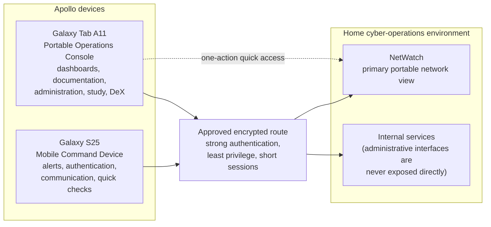
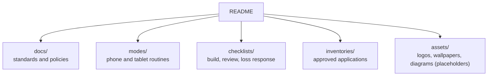

# Project Apollo Architecture

Project Apollo is a **documentation and design reference** for treating a phone and a tablet as secure, coordinated extensions of a home cyber-operations environment. It contains no live infrastructure, credentials, addresses or device identifiers. This document shows how the devices, security controls and documents relate. It reflects the repository's current planning status.

## System context

The repository deliberately does not prescribe a VPN, password manager, authenticator, SSH client or MDM product. Selected tools are recorded locally and only generic categories are published.

## Device roles

| | Galaxy S25 | Galaxy Tab A11 |
|---|---|---|
| Role | Mobile Command Device | Portable Operations Console |
| Use for | Alert-driven tasks of a few minutes, authentication, calls and messaging, bounded response actions, notes and sanitized evidence | Comparison, logs, typing, multiple windows and sustained attention: NetWatch triage, approved SSH or browser administration, documentation, study |
| Not for | Prolonged dashboard analysis, bulk administration, holding the only recovery copy | Routine use with elevated access. It uses a standard account and elevates only when needed, with reauthentication |

**Decision rule:** a short, alert-driven task goes to the phone. Anything that needs comparison, logs, typing or sustained attention goes to the tablet.

## Security model

Apollo assumes a device may be lost, stolen, observed in public or connected through an untrusted network.

| Control area | Where it is defined |
|---|---|
| Baseline hardening (unique unlock credentials, hidden lock-screen content, automatic updates, encryption, remote locate and wipe) | [security-baseline.md](docs/security-baseline.md), [device-roles.md](docs/device-roles.md) |
| Privacy | [privacy-standard.md](docs/privacy-standard.md) |
| Approved applications | [application-standard.md](docs/application-standard.md), [approved-applications.md](inventories/approved-applications.md) |
| Synchronization | [synchronization-policy.md](docs/synchronization-policy.md) |
| Backup and recovery | [backup-and-recovery.md](docs/backup-and-recovery.md) |
| Loss response | [lost-device-response.md](checklists/lost-device-response.md) |
| Ongoing review | [monthly-security-review.md](checklists/monthly-security-review.md) |

Recovery codes and break-glass material stay off-device, and secrets are never stored in notes, screenshots, downloads or source control.

## Repository map

| Directory | Contents |
|---|---|
| `docs/` | Overview, device roles, security baseline, privacy, applications, synchronization, NetWatch quick access, backup and recovery, visual identity, sanitization and publishing, roadmap |
| `modes/` | Separate phone and tablet modes |
| `checklists/` | Phone build, tablet build, monthly review, lost-device response |
| `inventories/` | Approved applications |
| `assets/` | Placeholders for logos, wallpapers, lock screens and screenshots, to be added only after source files and rights are verified |

## Publication boundary

Public evidence passes the [sanitization checklist](docs/portfolio-and-sanitization.md) first. The repository intentionally excludes credentials, private addresses, device identifiers, recovery codes, personal notifications, family information and live infrastructure screenshots.

## Status

The repository's README marks the project as **Planning** with a documentation baseline of v1.0.0. Nothing here claims that a mobile configuration has been deployed or validated.

## Related documents

[README](README.md) · [Project overview](docs/project-overview.md) · [Implementation roadmap](docs/implementation-roadmap.md) · [NetWatch quick access](docs/netwatch-quick-access.md)
